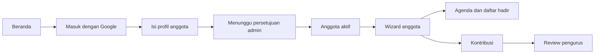
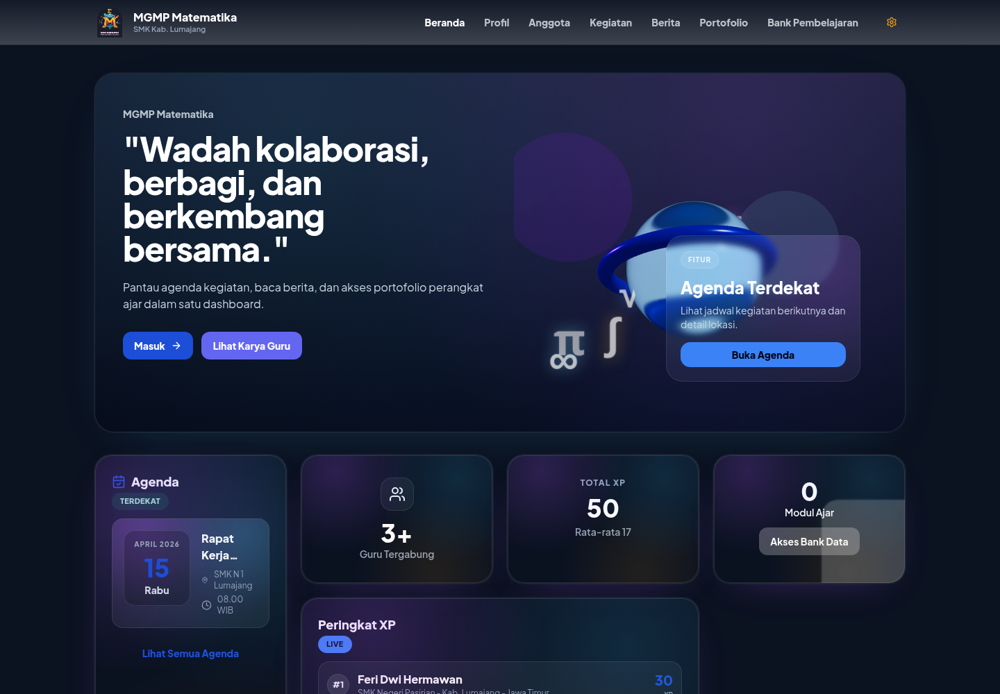
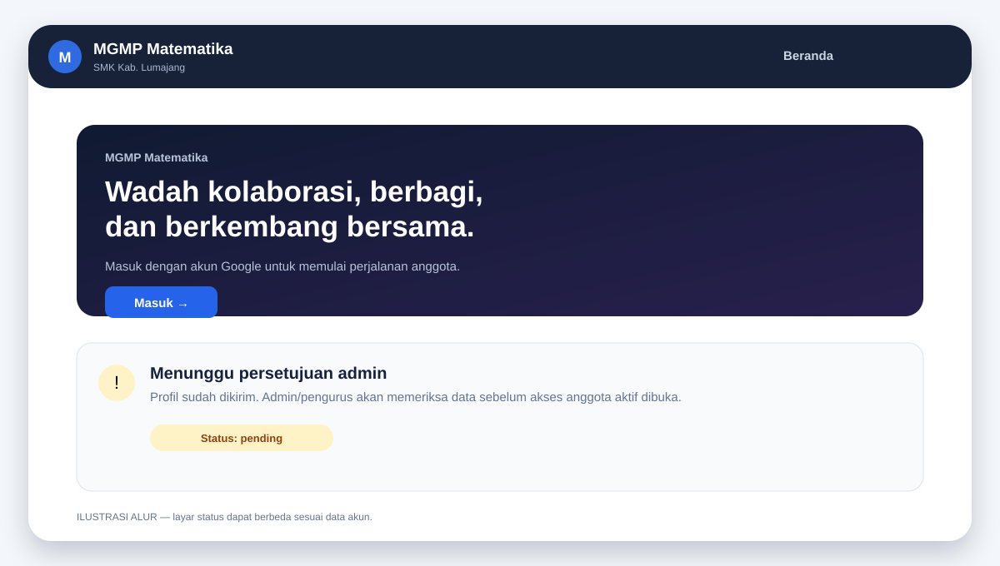
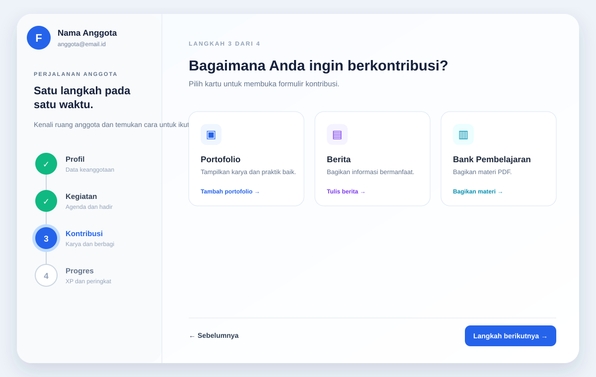
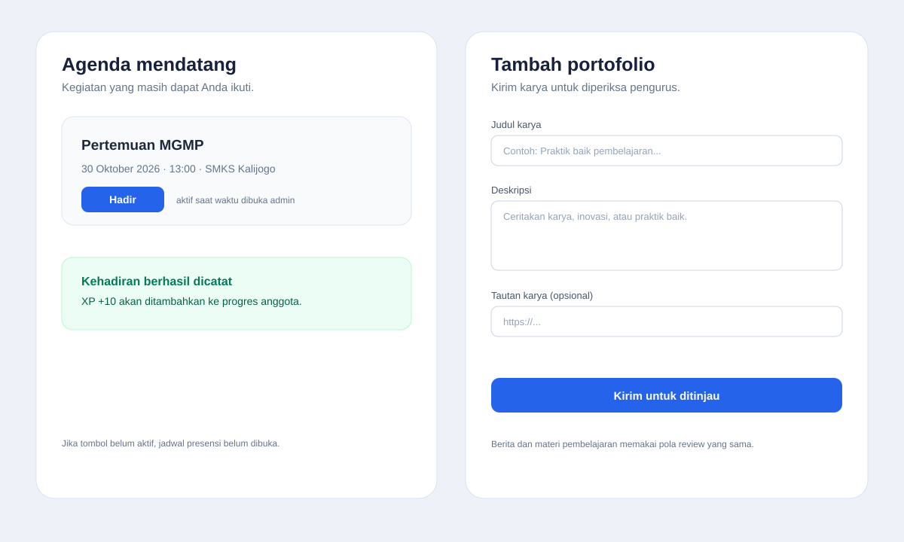
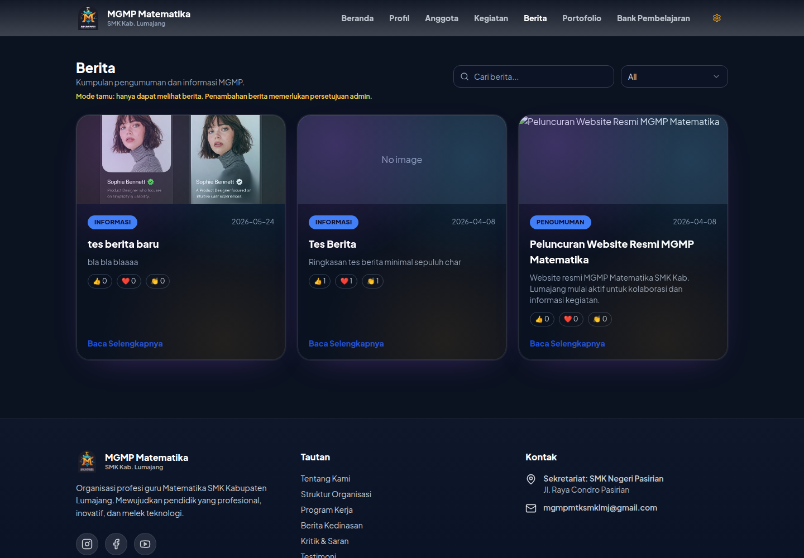
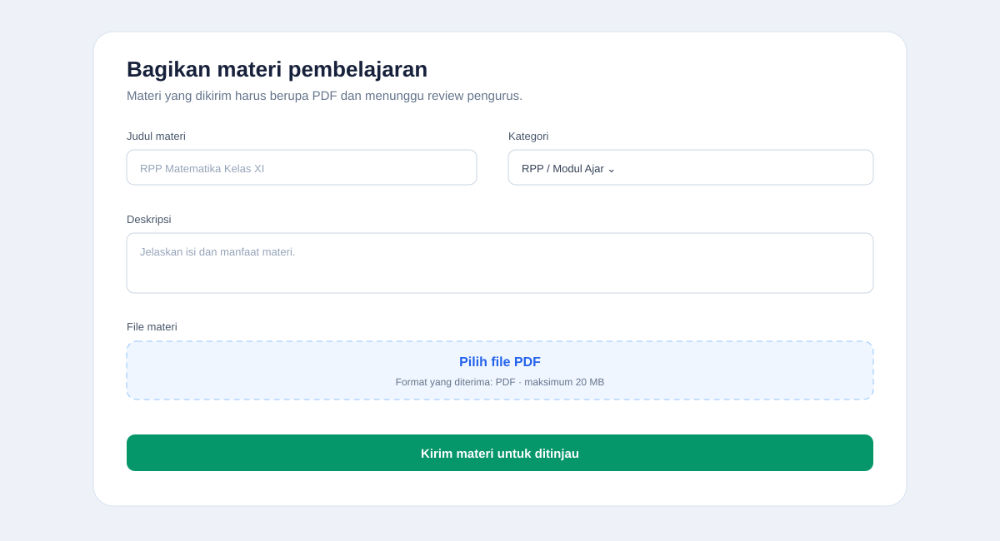
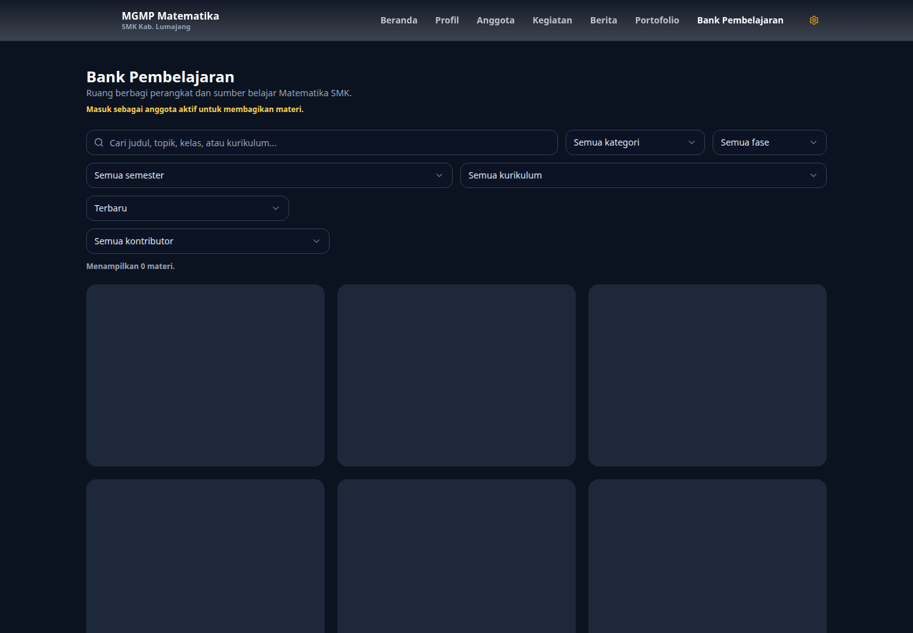

# Panduan Anggota Gemastika

Panduan ini menjelaskan alur penggunaan Gemastika sebagai anggota: masuk dengan Google, melengkapi profil, menunggu persetujuan admin, mengisi daftar hadir kegiatan, dan mengirim kontribusi.

> **Catatan gambar:** gambar berformat PNG adalah tangkapan layar dari aplikasi lokal. Gambar berformat SVG yang diberi label **Ilustrasi alur** menggambarkan layar khusus anggota yang memerlukan sesi login aktif.

## Ringkasan alur

## 1. Masuk sebagai anggota

1. Buka alamat Gemastika. Saat mengembangkan aplikasi di komputer sendiri, alamatnya biasanya `http://localhost:5173`.
2. Pada beranda, klik **Masuk**.
3. Pilih akun Google yang akan digunakan sebagai akun anggota.
4. Berikan persetujuan yang diminta oleh Google.
5. Jika ini pertama kali masuk, lengkapi profil anggota. Isi nama lengkap, sekolah, dan minimal salah satu kontak: WhatsApp atau Telegram.
6. Simpan profil.

Jika muncul `redirect_uri_mismatch`, alamat callback Google OAuth pada server belum sama dengan alamat aplikasi. Hubungi admin/pengelola aplikasi; masalah ini tidak dapat diselesaikan dari halaman anggota.

## 2. Menunggu persetujuan admin

Setelah profil dikirim, akun berada pada status **Menunggu persetujuan**. Pada tahap ini:

- Anda masih dapat membaca konten publik.
- Anda belum dapat mengisi daftar hadir.
- Anda belum dapat mengirim portofolio, berita, atau materi Bank Pembelajaran.
- Admin atau pengurus memeriksa data akun dan mengubah status menjadi **Anggota aktif**.

Setelah mendapat kabar bahwa akun sudah disetujui:

1. Muat ulang halaman, atau keluar lalu masuk kembali dengan akun Google yang sama.
2. Buka beranda `/`. Akun aktif akan diarahkan ke ruang anggota berbentuk wizard.
3. Alamat lama `/dashboard/anggota` tetap mengarah ke ruang anggota.

## 3. Mengenali wizard anggota

Wizard memiliki empat langkah:

1. **Profil** — melihat profil pribadi dan mengedit data anggota.
2. **Kegiatan** — melihat agenda mendatang, mengisi presensi, dan melihat riwayat kegiatan.
3. **Kontribusi** — menambah portofolio, menulis berita, atau membagikan materi.
4. **Progres** — melihat XP dan peringkat anggota.

Klik kartu di sisi kanan untuk membuka modal. Navigasi **Langkah berikutnya** dan **Sebelumnya** dapat digunakan untuk berpindah langkah. Tombol mode gelap/terang tersedia di bagian atas wizard.

## 4. Mengisi daftar hadir kegiatan

Presensi hanya tersedia untuk anggota aktif dan hanya pada waktu yang sudah dibuka oleh admin/pengurus.

1. Buka langkah **Kegiatan**.
2. Pilih kartu agenda mendatang.
3. Periksa tanggal, waktu, dan lokasi kegiatan.
4. Klik **Hadir** saat tombol tersedia.
5. Tunggu pesan **Kehadiran berhasil dicatat**.

Kehadiran yang berhasil dicatat memberikan XP sesuai aturan aplikasi. Jika tombol belum bisa digunakan, kemungkinan presensi belum dikonfigurasi, belum memasuki waktu buka, atau waktu presensi sudah ditutup.

### Status tombol Hadir

| Status | Arti | Tindakan |
| --- | --- | --- |
| Belum diatur | Admin belum menentukan jendela presensi | Tunggu informasi dari admin/pengurus |
| Belum dibuka | Waktu kegiatan belum masuk jendela presensi | Coba lagi saat waktu buka tiba |
| Hadir | Kehadiran sudah tercatat | Tidak perlu mengirim ulang |
| Ditutup | Batas waktu presensi sudah lewat | Hubungi pengurus bila ada koreksi |

Untuk melihat kegiatan yang telah selesai, buka kartu **Riwayat kegiatan** pada langkah Kegiatan. Riwayat tersebut berisi daftar kegiatan, tanggal, lokasi, dan status selesai.

## 5. Berkontribusi

Buka langkah **Kontribusi**, lalu pilih salah satu kartu. Setiap kiriman masuk ke status review dan baru tampil untuk publik setelah disetujui admin/pengurus.

### 5.1 Menambah portofolio

1. Klik kartu **Portofolio**.
2. Isi judul karya.
3. Periksa nama guru dan sekolah yang terisi dari profil.
4. Tulis deskripsi karya, inovasi, atau praktik baik.
5. Tambahkan tautan karya atau foto jika tersedia.
6. Klik **Kirim untuk ditinjau**.

Portofolio akan berstatus menunggu pemeriksaan. Jika disetujui, karya dapat dilihat pada halaman publik **Portofolio**.

### 5.2 Menulis berita

1. Klik kartu **Berita**.
2. Isi judul, kategori, tanggal, ringkasan, dan isi berita.
3. Gunakan bahasa yang jelas dan pastikan informasi sudah benar.
4. Tambahkan gambar atau dokumen pendukung jika tersedia.
5. Klik tombol kirim.

Berita dikirim ke pengurus untuk diperiksa. Berita yang belum disetujui tetap menjadi kiriman Anda dan belum tampil sebagai konten publik.

Halaman publik Berita dapat dibuka untuk membaca berita yang sudah tersedia. Pengguna umum hanya dapat membaca; tombol untuk menulis berita tidak tampil bagi pengguna yang belum masuk sebagai anggota aktif.

### 5.3 Membagikan materi Bank Pembelajaran

1. Klik kartu **Bank Pembelajaran** pada langkah Kontribusi.
2. Isi judul, kategori, deskripsi, fase, kelas, topik, semester, kurikulum, dan tag bila relevan.
3. Pilih file materi.
4. Pastikan file benar-benar berformat **PDF** dan ukurannya tidak lebih dari **20 MB**.
5. Klik **Kirim materi untuk ditinjau**.

File selain PDF ditolak oleh aplikasi. Setelah dikirim, materi berstatus menunggu review. Materi yang disetujui dapat dibaca pada halaman publik `/bank-pembelajaran`; detail materi menampilkan isi PDF secara langsung di halaman.

Untuk membaca materi yang sudah tersedia, buka **Jelajahi Bank Pembelajaran** atau alamat `/bank-pembelajaran`. Pengguna tanpa login tetap dapat membaca materi publik, tetapi tidak melihat tombol **Tambah Materi**.

## 6. Batas akses pengguna umum

Pengguna yang belum login atau belum disetujui sebagai anggota aktif:

- tidak melihat tombol **Tambah portofolio**;
- tidak melihat tombol **Tulis berita**;
- tidak melihat tombol **Bagikan materi** atau **Tambah Materi**;
- tetap dapat membaca halaman publik yang diizinkan, termasuk Berita, Portofolio, dan Bank Pembelajaran.

Pembatasan juga diperiksa oleh server. Mengakses alamat API secara langsung tidak dapat melewati status anggota.

## 7. Masalah yang sering terjadi

| Masalah | Kemungkinan penyebab | Solusi |
| --- | --- | --- |
| Gagal masuk Google | Konfigurasi OAuth atau callback belum sesuai | Hubungi pengelola aplikasi dan sertakan pesan error |
| Masih melihat status pending | Admin belum menyetujui akun | Tunggu konfirmasi admin/pengurus |
| Wizard belum muncul setelah disetujui | Sesi lama masih tersimpan | Muat ulang, lalu keluar dan masuk kembali |
| Tombol Hadir tidak tersedia | Jendela presensi belum dibuka atau sudah ditutup | Cek jadwal dan hubungi pengurus |
| Kiriman belum muncul di publik | Masih menunggu review | Tunggu persetujuan admin/pengurus |
| Materi gagal dikirim | File bukan PDF, PDF rusak, atau lebih dari 20 MB | Pilih PDF yang valid dan sesuai batas ukuran |

## 8. Checklist singkat anggota

- [ ] Masuk dengan akun Google yang benar.
- [ ] Profil berisi nama, sekolah, dan minimal satu kontak.
- [ ] Status akun sudah **Anggota aktif**.
- [ ] Presensi diisi saat jendela waktu masih terbuka.
- [ ] Portofolio, berita, dan materi ditulis dengan informasi yang benar.
- [ ] Materi Bank Pembelajaran disiapkan dalam format PDF maksimal 20 MB.
- [ ] Kiriman dicek kembali setelah review admin/pengurus.
